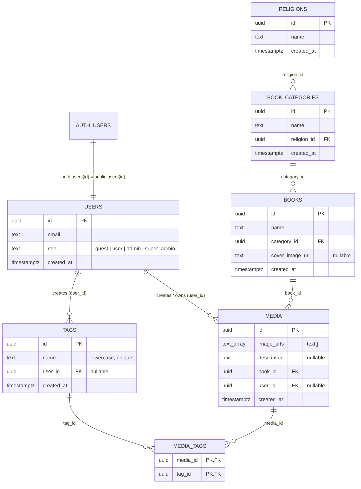

# Handover Documentation: Project Summary, Supabase Architecture & RLS Policies

**Project:** Praman Hai (Pradarshani App)  
**Document:** Handover & Architecture Specification  
**Date:** October 2026  
**Primary Tech Stack:** React, TypeScript, Vite, Tailwind CSS, Supabase (PostgreSQL, Auth, Storage)

---

## 1. Project Overview & Business Logic

**Praman Hai** is a digital reference and proof-verification archive. It provides a structured catalog of theological and historical literature organized in a 3-tier hierarchy:
$$\text{Religion} \longrightarrow \text{Book Category} \longrightarrow \text{Book} \longrightarrow \text{Media Items (Proofs)}$$

### Core Workflows:
1. **Browsing / Hierarchy Exploration:** Users can navigate through religions, categories, and books via an interactive folder explorer (`FolderExplorer.tsx`).
2. **Search:** Users can search references using multi-tag autocomplete with live filtering (`SearchResults.tsx`).
3. **Multi-Image Proof Viewer:** Each proof can hold multiple high-resolution images, full descriptions, book metadata, and multiple searchable tags.
4. **Access Control & User Approval Flow:** Anyone can register via Email or Google OAuth, but all new signups default to the `guest` role. Guests are blocked by a disguised `404 Not Found` screen until a `super_admin` manually approves them in Supabase by changing their role to `user`, `admin`, or `super_admin`.

---

## 2. Supabase Database Architecture

### 2.1 Entity Relationship Diagram



---

### 2.2 Table Schemas & Foreign Keys

#### 1. `public.users`
Stores user profile information, role-based authorization levels, and user emails.
* **`id`** (`uuid`, Primary Key): References `auth.users(id)` with `ON DELETE CASCADE`.
* **`email`** (`text`): User's email address copied automatically on registration.
* **`user_name`** (`text`, Nullable): Display name (from the Google profile when available). The UI falls back to `email` when empty. Requires `ALTER TABLE public.users ADD COLUMN user_name text;` (used by the super-admin dashboard).
* **`role`** (`text`, Default: `'guest'`): Allowed values: `'guest'`, `'user'`, `'admin'`, `'super_admin'`.
* **`created_at`** (`timestamptz`, Default: `now()`).

#### 2. `public.religions`
Top-level categorization (e.g., Islam, Hinduism, Christianity, etc.).
* **`id`** (`uuid`, Primary Key, Default: `gen_random_uuid()`).
* **`name`** (`text`, Not Null, Unique).
* **`created_at`** (`timestamptz`, Default: `now()`).

#### 3. `public.book_categories`
Second-level category under a religion (e.g., Hadith, Vedas, Quranic Tafseer, etc.).
* **`id`** (`uuid`, Primary Key, Default: `gen_random_uuid()`).
* **`name`** (`text`, Not Null).
* **`religion_id`** (`uuid`, Foreign Key $\rightarrow$ `public.religions(id)` `ON DELETE CASCADE`).
* **`created_at`** (`timestamptz`, Default: `now()`).

#### 4. `public.books`
The literature item containing the reference proofs.
* **`id`** (`uuid`, Primary Key, Default: `gen_random_uuid()`).
* **`name`** (`text`, Not Null).
* **`category_id`** (`uuid`, Foreign Key $\rightarrow$ `public.book_categories(id)` `ON DELETE CASCADE`).
* **`cover_image_url`** (`text`, Nullable): Public URL pointing to Supabase Storage bucket.
* **`created_at`** (`timestamptz`, Default: `now()`).

#### 5. `public.tags`
Searchable keywords attached to proofs. All tag names are stored in lowercase.
* **`id`** (`uuid`, Primary Key, Default: `gen_random_uuid()`).
* **`name`** (`text`, Not Null, Unique).
* **`user_id`** (`uuid`, Foreign Key $\rightarrow$ `auth.users(id)` `ON DELETE SET NULL`, Default: `auth.uid()`): Creator tracking.
* **`created_at`** (`timestamptz`, Default: `now()`).

#### 6. `public.media`
The core proof record.
* **`id`** (`uuid`, Primary Key, Default: `gen_random_uuid()`).
* **`image_urls`** (`text[]`, Not Null): Array of public URLs for all uploaded proof pages/images (migrated from single `image_url: text` to `image_urls: text[]`).
* **`description`** (`text`, Nullable): Detailed explanation or textual proof transcription.
* **`book_id`** (`uuid`, Foreign Key $\rightarrow$ `public.books(id)` `ON DELETE CASCADE`).
* **`user_id`** (`uuid`, Foreign Key $\rightarrow$ `auth.users(id)` `ON DELETE SET NULL`, Default: `auth.uid()`): User who uploaded the media.
* **`created_at`** (`timestamptz`, Default: `now()`).

#### 7. `public.media_tags`
Many-to-Many join table linking `media` and `tags`.
* **`media_id`** (`uuid`, Foreign Key $\rightarrow$ `public.media(id)` `ON DELETE CASCADE`).
* **`tag_id`** (`uuid`, Foreign Key $\rightarrow$ `public.tags(id)` `ON DELETE CASCADE`).
* **Primary Key:** `(media_id, tag_id)`.

#### 8. Supabase Storage Bucket: `media-uploads`
* **Configuration:** Public bucket.
* **Folders:** 
  - `proofs/`: Holds high-resolution proof images (`proofs/<timestamp>_<hash>.<ext>`).
  - `book-covers/`: Holds cover thumbnails for books.

---

## 3. Database Functions, Triggers & Auth Setup

### 3.1 Security Helper: `get_user_role()`
To avoid infinite recursive RLS lookups on `public.users`, this `SECURITY DEFINER` function extracts the active user's role safely:

```sql
CREATE OR REPLACE FUNCTION public.get_user_role()
RETURNS text
LANGUAGE sql
SECURITY DEFINER
SET search_path = public
AS $$
  SELECT role FROM public.users WHERE id = auth.uid();
$$;
```

### 3.2 Auto-Registration & Role Gate Trigger: `handle_new_user()`
Whenever a user signs up (via Email/Password OR Google OAuth), Supabase triggers this function to insert them into `public.users` with the `'guest'` role and save their email:

```sql
CREATE OR REPLACE FUNCTION public.handle_new_user()
RETURNS trigger
LANGUAGE plpgsql
SECURITY DEFINER
SET search_path = public
AS $$
BEGIN
  INSERT INTO public.users (id, email, role)
  VALUES (NEW.id, NEW.email, 'guest');
  RETURN NEW;
END;
$$;

DROP TRIGGER IF EXISTS on_auth_user_created ON auth.users;
CREATE TRIGGER on_auth_user_created
  AFTER INSERT ON auth.users
  FOR EACH ROW EXECUTE PROCEDURE public.handle_new_user();
```

### 3.3 Super-admin dashboard support (`/admin/dashboard`)
* **`get_media_storage_bytes()`** — `SECURITY DEFINER` RPC returning total bytes in the `media-uploads` bucket (`sum(storage.objects.metadata->>'size')`). Returns `NULL` unless the caller is `super_admin`; the dashboard shows "Unavailable" for `NULL`. `EXECUTE` is granted to `authenticated` only.
* **`guard_role_change()` + trigger `users_role_guard`** — `BEFORE UPDATE` on `public.users`: only `super_admin` may change `role`. Needed because the policy "Users can update their own profile" has no column restriction, so without the trigger any user could promote themselves. Calls with no JWT (`auth.uid() IS NULL`: Supabase dashboard / service role) are allowed, so manual promotion still works.

---

## 4. Row Level Security (RLS) Policies

All tables and the storage bucket have RLS explicitly enabled.

### 4.1 Summary of Access Rights Matrix

| Table / Resource | Public / Guest | User | Admin | Super Admin |
| :--- | :---: | :---: | :---: | :---: |
| **`users`** | ❌ None | View All | View All / Edit Own | View All / Manage All |
| **`religions`** | View Only | View Only | View Only | Full CRUD |
| **`book_categories`** | View Only | View Only | View Only | Full CRUD |
| **`books`** | View Only | View Only | View Only (UI Edit via Storage) | Full CRUD |
| **`media`** | View Only | View Only | Insert / Edit Own / Delete Own | Full CRUD |
| **`tags`** | View Only | View Only | Insert / Edit / Delete Orphan | Full CRUD |
| **`media_tags`** | View Only | View Only | Insert / Edit Own / Delete Own | Full CRUD |
| **`media-uploads` (Storage)** | View Only | View Only | Upload / Delete Own | Full Storage Control |

---

### 4.2 Complete SQL Migration for RLS Policies

```sql
-- 1. Enable RLS on all tables
ALTER TABLE public.users ENABLE ROW LEVEL SECURITY;
ALTER TABLE public.religions ENABLE ROW LEVEL SECURITY;
ALTER TABLE public.book_categories ENABLE ROW LEVEL SECURITY;
ALTER TABLE public.books ENABLE ROW LEVEL SECURITY;
ALTER TABLE public.media ENABLE ROW LEVEL SECURITY;
ALTER TABLE public.tags ENABLE ROW LEVEL SECURITY;
ALTER TABLE public.media_tags ENABLE ROW LEVEL SECURITY;

-- 2. USERS Policies
CREATE POLICY "Users can view all users" 
  ON public.users FOR SELECT 
  USING (auth.role() = 'authenticated');

CREATE POLICY "Users can update their own profile" 
  ON public.users FOR UPDATE 
  USING (auth.uid() = id);

CREATE POLICY "Super admins can do all on users" 
  ON public.users FOR ALL 
  USING (public.get_user_role() = 'super_admin');

-- 3. RELIGIONS, CATEGORIES, BOOKS Policies
CREATE POLICY "Anyone can view religions" ON public.religions FOR SELECT USING (true);
CREATE POLICY "Anyone can view book_categories" ON public.book_categories FOR SELECT USING (true);
CREATE POLICY "Anyone can view books" ON public.books FOR SELECT USING (true);

CREATE POLICY "Super admin all on religions" ON public.religions FOR ALL USING (public.get_user_role() = 'super_admin');
CREATE POLICY "Super admin all on book_categories" ON public.book_categories FOR ALL USING (public.get_user_role() = 'super_admin');
CREATE POLICY "Super admin all on books" ON public.books FOR ALL USING (public.get_user_role() = 'super_admin');

-- 4. TAGS Policies
CREATE POLICY "Anyone can view tags" ON public.tags FOR SELECT USING (true);

CREATE POLICY "Admin and Super admin can insert tags" 
  ON public.tags FOR INSERT 
  WITH CHECK (public.get_user_role() IN ('admin', 'super_admin'));

CREATE POLICY "Admin and Super admin can update tags" 
  ON public.tags FOR UPDATE 
  USING (public.get_user_role() IN ('admin', 'super_admin'));

CREATE POLICY "Admin can delete orphan tags, Super admin can delete all tags" 
  ON public.tags FOR DELETE 
  USING (
    public.get_user_role() = 'super_admin' OR 
    (public.get_user_role() = 'admin' AND NOT EXISTS (SELECT 1 FROM public.media_tags mt WHERE mt.tag_id = id))
  );

-- 5. MEDIA Policies
CREATE POLICY "Anyone can view media" ON public.media FOR SELECT USING (true);

CREATE POLICY "Admin and Super admin can insert media" 
  ON public.media FOR INSERT 
  WITH CHECK (public.get_user_role() IN ('admin', 'super_admin'));

CREATE POLICY "Admin can update own media, Super admin can update all" 
  ON public.media FOR UPDATE 
  USING (
    public.get_user_role() = 'super_admin' OR 
    (public.get_user_role() = 'admin' AND user_id = auth.uid())
  );

CREATE POLICY "Admin can delete own media, Super admin can delete all" 
  ON public.media FOR DELETE 
  USING (
    public.get_user_role() = 'super_admin' OR 
    (public.get_user_role() = 'admin' AND user_id = auth.uid())
  );

-- 6. MEDIA_TAGS Policies
CREATE POLICY "Anyone can view media_tags" ON public.media_tags FOR SELECT USING (true);

CREATE POLICY "Admin and Super admin can insert media_tags" 
  ON public.media_tags FOR INSERT 
  WITH CHECK (public.get_user_role() IN ('admin', 'super_admin'));

CREATE POLICY "Admin can modify own media_tags, Super admin can modify all" 
  ON public.media_tags FOR UPDATE 
  USING (
    public.get_user_role() = 'super_admin' OR 
    (public.get_user_role() = 'admin' AND EXISTS (SELECT 1 FROM public.media m WHERE m.id = media_id AND m.user_id = auth.uid()))
  );

CREATE POLICY "Admin can delete own media_tags, Super admin can delete all" 
  ON public.media_tags FOR DELETE 
  USING (
    public.get_user_role() = 'super_admin' OR 
    (public.get_user_role() = 'admin' AND EXISTS (SELECT 1 FROM public.media m WHERE m.id = media_id AND m.user_id = auth.uid()))
  );

-- 7. STORAGE (Bucket: 'media-uploads') Policies
CREATE POLICY "Anyone can view media-uploads" 
  ON storage.objects FOR SELECT 
  USING (bucket_id = 'media-uploads');

CREATE POLICY "Admin and Super admin can insert media-uploads" 
  ON storage.objects FOR INSERT 
  WITH CHECK (bucket_id = 'media-uploads' AND public.get_user_role() IN ('admin', 'super_admin'));

CREATE POLICY "Admin can update own media-uploads, Super admin can update all" 
  ON storage.objects FOR UPDATE 
  USING (
    bucket_id = 'media-uploads' AND (
      public.get_user_role() = 'super_admin' OR 
      (public.get_user_role() = 'admin' AND owner = auth.uid())
    )
  );

CREATE POLICY "Admin can delete own media-uploads, Super admin can delete all" 
  ON storage.objects FOR DELETE 
  USING (
    bucket_id = 'media-uploads' AND (
      public.get_user_role() = 'super_admin' OR 
      (public.get_user_role() = 'admin' AND owner = auth.uid())
    )
  );
```

---

## 5. Summary of Key Features & Work Accomplished

### 5.1 Multi-Image Upload & Carousel Viewer
- Upgraded the `media` schema from single `image_url` string to `image_urls: string[]`.
- Built carousel preview in `ImageViewerModal.tsx` allowing keyboard navigation (arrow keys), swipe navigation, thumbnail switching, and full-screen lightbox.
- Added image count badge indicators to thumbnail previews in `ResultItemCard.tsx`.
- Updated `EditMediaModal.tsx` and `AdminDashboard.tsx` to allow adding multiple proof pages simultaneously and removing individual pages.
- Storage cleanup: When a media item is deleted or updated with fewer images, deleted images are purged directly from the Supabase storage bucket (`deleteImageFromStorage`).

### 5.2 Smart Client-Side Image Compression
- Configured in `src/utils/imageCompression.ts` using `browser-image-compression`.
- **Threshold Rule:** Only images strictly larger than **600 KB** (`file.size > 600 * 1024`) undergo compression. Images 600 KB or smaller bypass the compression worker entirely to preserve 100% original quality.
- Compresses to max 0.6 MB, max dimension 1920px, initial quality 0.8.

### 5.3 User Role Gate & Disguised 404
- All new users register with the `guest` role.
- In `App.tsx`, `PrivateRoute` inspects `userRole`. If `userRole === 'guest'`, the application intercepts the route and renders `Guest404.tsx`.
- **Disguised Security:** Instead of telling visitors their account is pending approval, `Guest404.tsx` displays a realistic technical error:
  `Error: Route mismatch [ERR_NO_MATCH]`
  `Path: /`
  `Message: The requested URL was not found on this server. The routing configuration failed to resolve a matching handler for this endpoint.`
- Includes a subtle "Return to Home" button that secretly calls `logout()`, clearing their session without alerting unwanted users.

### 5.4 Google OAuth Authentication
- Added Google Sign-In via `supabase.auth.signInWithOAuth({ provider: 'google' })` to both `AdminLogin.tsx` and `Register.tsx`.
- Customized centered pill buttons with official Google SVG icons.
- Works seamlessly with the Supabase auth trigger to register the user in `public.users` with `'guest'` role.

### 5.5 URL-Driven Modal & Folder Navigation (Hardware Back Button Support)
- **Problem Solved:** On mobile devices, pressing the physical Android/iOS back button closed the entire website or navigated away instead of closing open modals.
- **Solution:**
  - Implemented `src/hooks/useHistoryModal.ts`: Synchronizes modal visibility with browser URL query parameters (`?preview=...`, `?edit=...`).
  - Added `wasOpenRef` synchronization logic to prevent React Router race conditions from accidentally closing modals on double-taps.
  - Linked `FolderExplorer.tsx` breadcrumbs and navigation depth to the `fpath` URL query parameter, enabling full browser back-and-forth folder traversal.
  - Search queries and tag filters in `SearchResults.tsx` use `{ replace: true }`, ensuring an entire search exploration session occupies only a single entry in history so a single Back press returns cleanly to Home.

### 5.6 Mobile Long-Press Interaction
- Created `src/hooks/useLongPress.ts`.
- On mobile devices, users can long-press a book card to trigger the `EditBookModal` (updating book title and uploading new book cover images). On desktop, standard click behavior is preserved.

### 5.7 Progressive Web App (PWA) & Mobile Installability
- Created `public/manifest.json` configured for standalone mobile execution with name "Praman Hai".
- Generated and configured strict 192x192 and 512x512 **PNG** icons (`icon-192.png`, `icon-512.png`), satisfying Google Chrome's strict PWA install heuristic (preventing Chrome from downgrading the install to a mere "create shortcut" action).
- Created native `public/sw.js` (Service Worker) and registered it in `src/main.tsx`.
- Updated `index.html` viewport meta tags to prevent unintended double-tap zooming on mobile.

### 5.8 Tag Management & Orphan Cleanup
- Implemented `cleanupOrphanTags()` in `mediaService.ts`: Whenever media is deleted or tags are unlinked, unused tags with zero associations in `media_tags` are automatically removed from `public.tags`.
- Search suggestions only show tags that are currently linked to at least one media proof (`fetchAllTags(true)`).

---

## 6. Directory Structure Guide

```
pradarshani_app/
├── public/
│   ├── favicon.svg          # App vector favicon
│   ├── icon-192.png         # PWA icon 192x192 PNG
│   ├── icon-512.png         # PWA icon 512x512 PNG
│   ├── manifest.json        # Web app manifest
│   ├── sw.js                # Minimal Service Worker
│   └── _redirects           # Netlify SPA routing rules
├── src/
│   ├── components/
│   │   ├── Button.tsx           # Standardized button with loading & icon support
│   │   ├── ConfirmModal.tsx     # Custom confirmation dialogs
│   │   ├── EditBookModal.tsx    # Modal to change book title & cover image
│   │   ├── EditMediaModal.tsx   # Modal to edit proofs, multi-images & tags
│   │   ├── FolderCard.tsx       # Folder / Item visual card
│   │   ├── FolderExplorer.tsx   # Hierarchy browser (Religion -> Category -> Book)
│   │   ├── Header.tsx           # App navbar & user profile / logout
│   │   ├── ImageViewerModal.tsx # Multi-image lightbox carousel
│   │   ├── Input.tsx            # Styled input with error states
│   │   ├── ResultItemCard.tsx   # Search result card with badges & preview
│   │   └── SearchableSelect.tsx # Dropdown with tag search
│   ├── context/
│   │   └── AuthContext.tsx      # Auth state, user roles, session listener
│   ├── hooks/
│   │   ├── useHistoryModal.ts   # URL query parameter <-> Modal sync hook
│   │   └── useLongPress.ts      # Mobile long-press gesture hook
│   ├── pages/
│   │   ├── AdminDashboard.tsx   # Proof uploader & media management
│   │   ├── AdminLogin.tsx       # Login page (Email & Google)
│   │   ├── ForgotPassword.tsx   # Password recovery request
│   │   ├── Guest404.tsx         # Disguised 404 security gate for guests
│   │   ├── Home.tsx             # Main dashboard & Folder Explorer view
│   │   ├── Register.tsx         # New user registration
│   │   ├── ResetPassword.tsx    # Set new password page
│   │   └── SearchResults.tsx    # Tag & keyword search page
│   ├── services/
│   │   └── mediaService.ts      # All Supabase database & storage queries
│   ├── types/
│   │   └── database.ts          # TypeScript interfaces for Supabase tables
│   ├── utils/
│   │   ├── imageCompression.ts # 600 KB threshold image compressor
│   │   └── search.ts           # Fuzzy tag matching & filtering utilities
│   ├── App.tsx                  # Main routes & PrivateRoute role guards
│   ├── main.tsx                 # Entry point & Service Worker registration
│   └── supabase.ts              # Supabase Client initialization
├── index.html                   # HTML entry point with PWA metadata
├── package.json                 # Dependencies & scripts
└── tsconfig.json                # TypeScript compiler configuration
```

---

## 7. Important Caveats & Guidance for the Next AI / Developer

1. **TypeScript Rules (`verbatimModuleSyntax`):**
   - The TypeScript configuration uses `verbatimModuleSyntax: true`.
   - When importing types, you **must** use the `type` keyword (e.g. `import type { User } from '@supabase/supabase-js';`), otherwise the Vite/tsc build will fail.

2. **User Role Approvals:**
   - Newly created users will always see the 404 error page until someone manually opens the Supabase dashboard (`public.users` table) and changes their `role` from `'guest'` to `'user'`, `'admin'`, or `'super_admin'`.

3. **Storage Deletion & Cascade:**
   - Deleting a media record deletes rows in `media` and `media_tags` via SQL cascade, but PostgreSQL does **not** automatically delete physical files in Supabase Storage.
   - Always rely on `deleteMediaRecord()` in `mediaService.ts`, which deletes the DB record and then iteratively calls `deleteImageFromStorage()`.

4. **Preserving User Edits:**
   - Always preserve modifications made by the repository owner unless explicitly requested to undo them.
